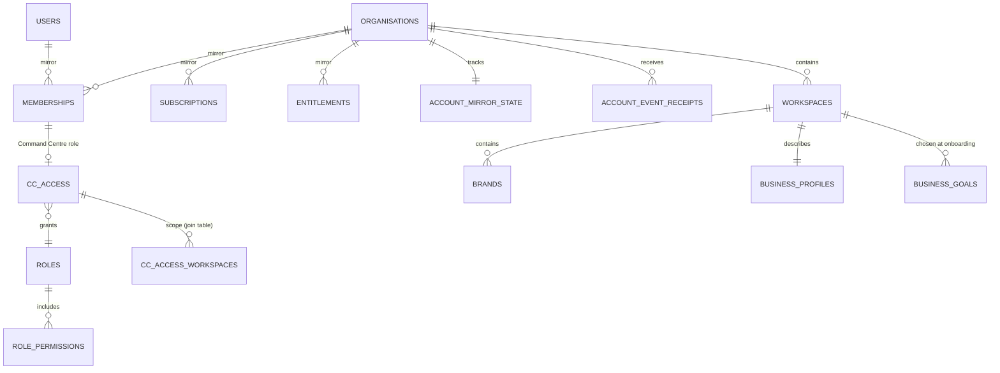
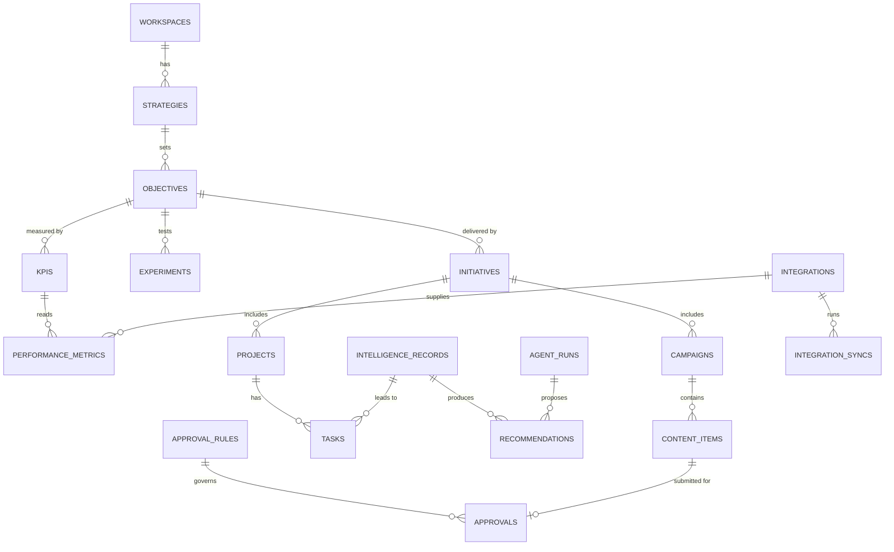

# Command Centre data model review

Date: 18 November 2026. Reviews the current schema (`supabase/migrations/`) and the proposed model
(`docs/specs/02-data-model.md`, `03`, `10`, `13`) against the master brief (`docs/blueprint.md`). **No
migration was written or applied.** Proposals here are for folding into spec 02 before milestone M2b.

## 1. Current schema

One migration, `20261117000001_foundation.sql`:

| Object | Purpose |
|---|---|
| Default privileges | New tables, sequences and functions in `public` get nothing for `anon` or `authenticated` |
| `revoke create on schema public from public` | Nobody but the owner creates objects in `public` |
| `app` schema | Home for policy helper functions; usage granted to `authenticated` and `service_role` |
| `app.tables_missing_rls` | Lists `public` tables without RLS or without a policy; tests fail if it returns rows |
| `cc_meta.migrations` | Created by the runner (not a migration): applied migration names |

There are **no domain tables**. Every entity below is "specified only".

## 2. Coverage of the brief

| Area (brief section) | Spec 02 tables | Verdict |
|---|---|---|
| Organisations (§6) | `organisations` (mirror), `org_relationships` (mirror) | Covered |
| Users and memberships (§6) | `users`, `memberships` (mirrors), `cc_access`, `roles`, `permissions`, `role_permissions`, `teams`, `team_members`, `user_preferences` | Covered; scope arrays need change (§4.2) |
| Workspaces and brands (§6) | `workspaces`, `brands`, `locations` | Covered |
| Business profile (§5) | `business_profiles`, `offerings` | Covered |
| Business goals and objectives (§4.03) | `strategies`, `objectives`, `kpis`, `initiatives`, `swot_items`, `learnings` | Covered. "Business goals" chosen at onboarding (J1) have no table: **gap G1** |
| Strategies and initiatives (§4.03) | as above | Covered |
| Campaigns and content (§4.04) | `campaigns`, `content_items`, `channel_plans` | Covered; content workflow states and approvals partly (§3 G7) |
| Projects and tasks (§11) | `projects`, `milestones`, `tasks`, `task_dependencies`, `comments` | Covered; saved views missing (G8) |
| Customer intelligence (§4.02) | `audiences`; feedback and sentiment intake (M02.5) has **no table**: **G2** |  Partial |
| Competitor intelligence | `competitors`, `intelligence_records` | Covered |
| Market trends, opportunities | `intelligence_records` (`source_type`) | Covered |
| AI agents and runs (§9) | `agents`, `agent_runs`, `agent_run_steps`, `recommendations` | Covered; agent templates and model registry are config (spec 08) |
| Knowledge and business context (§13) | `documents`, `document_chunks`, `files` | Covered |
| Approvals (§14) | `approvals` | Partial: approval **rules** (M10.4) have no table: **G3** |
| Integrations (§13) | `integrations` | Covered for connections; sync runs and errors history missing: **G9** |
| Reporting and performance (§12) | `performance_metrics`, `reports` | Covered |
| Experiments (pilot, M03.7) | **none**: **G4** | Missing |
| Cultural authority (pilot, X.1) | `intelligence_records.cultural_review` only; no workspace-level authority record or "not for AI tools" flag: **G5** | Partial |
| Demo and fixture data (X.2) | **none**: **G6** | Missing |
| Product entitlements and usage (§15) | `subscriptions`, `entitlements` (mirrors), `usage_events`, `credit_ledger` (spec 10) | Covered |
| Governance (§27) | `audit_events`, `record_versions`, `record_links` | Covered |
| Notifications (§4 Admin) | `notifications`; preferences (A.2) **no table**: **G10** | Partial |
| Ecosystem plumbing (spec 01 §6, 07, 13) | none for event receipts, webhooks out, idempotency, API clients: **G11–G14** | Missing |

## 3. Missing entities (proposed)

| # | Table | Key columns | Why |
|---|---|---|---|
| G1 | `business_goals` | `workspace_id`, `goal_key` or `text`, `priority`, `source` (`onboarding` \| `user`) | J1 asks the customer to choose goals; they seed objectives and agent priorities |
| G2 | `feedback_items` | `workspace_id`, `source` (`upload`, `review_site`, `survey`, `manual`), `source_ref jsonb`, `received_at`, `rating`, `text`, `sentiment`, `evidence_class`, `language` | M02.5 feedback and sentiment intake |
| G3 | `approval_rules` | `workspace_id null`, `kind`, `approver_role_id null`, `approver_user_ids` → join table, `min_approvals`, `allow_self_approval false` | M10.4; "approver" is a rule, not a role (spec 06 §2) |
| G4 | `experiments` | `workspace_id`, `objective_id`, `hypothesis`, `metric_key`, `baseline_start`, `baseline_end`, `minimum_acceptable`, `target`, `started_at`, `limitations`, `verdict`, `threshold_changed_at` | M03.7, adopted from the pilot |
| G5 | `cultural_authorities`, plus `ai_restricted bool` on documents and intelligence | `workspace_id`, `holder_name`, `contact`, `scope`, `rules text` | X.1: agents never receive content marked "not for AI tools" |
| G6 | `is_demo bool not null default false` on every core table (record convention) | — | X.2: flagged, badged and excluded from reports |
| G7 | `content_items.workflow_state` (`draft` → `review` → `approved` → `scheduled` → `published`), `approval_id` | — | M04.4; ties content to the Approval Centre |
| G8 | `saved_views` | `user_id`, `org_id`, `workspace_id`, `module`, `name`, `filters jsonb`, `sort jsonb`, `shared bool` | M07.2 saved views and filters |
| G9 | `integration_syncs` | `integration_id`, `started_at`, `finished_at`, `status`, `rows`, `error_code`, `error_detail` | Connection health and "last synced" (spec 01 risks) |
| G10 | `notification_preferences` | `user_id`, `org_id`, `kind`, `channel` (`in_app`, `email`, `push`), `enabled` | A.2 |
| G11 | `account_event_receipts`, `account_mirror_state` | `event_id` pk, `org_id`, `seq`, `type`, `received_at`; `org_id` pk, `last_seq`, `last_reconciled_at` | Idempotent, ordered mirror updates from the account service (ecosystem doc §4) |
| G12 | `webhook_endpoints`, `webhook_deliveries` | `org_id`, `url`, `secret_ref`, `events text[]`, `status`; `endpoint_id`, `event_id`, `attempt`, `status_code`, `next_attempt_at` | Webhooks out with a delivery log (spec 01 §6) |
| G13 | `idempotency_keys` | `org_id`, `principal`, `key`, `request_hash`, `response jsonb`, `created_at` (24 h) | `Idempotency-Key` on writes (spec 07 §2) |
| G14 | `external_links` (or keep `external_ref jsonb`) | `org_id`, `record_type`, `record_id`, `product`, `external_id`, `synced_at` | One indexed place to answer "which Command Centre record points at Reel Deal project X" (needed for incoming events) |

## 4. Relationships and constraints

### 4.1 Tenancy keys

- Every core table: `org_id not null`, plus `workspace_id` where workspace-scoped, and a composite
  foreign key `(workspace_id, org_id) references workspaces (id, org_id)` (spec 02 §4). Each parent
  needs `unique (id, org_id)` for this to work. Reel Deal uses exactly this pattern successfully.
- **Proposed:** every insert/update policy has `with check`, and `org_id` is never in an update grant,
  so a row cannot be moved between tenants even by its owner.

### 4.2 Arrays of ids

`cc_access.workspace_ids`, `cc_access.brand_ids`, `campaigns.audience_ids`, `approvals.approver_ids`
cannot carry foreign keys, so nothing stops an id from another organisation being stored.

**Proposed:** replace with join tables carrying `org_id` and composite foreign keys:
`cc_access_workspaces`, `cc_access_brands`, `campaign_audiences`, `approval_approvers`. Required for
`cc_access` (it is a security boundary); recommended for the others.

### 4.3 Polymorphic references

`approvals (record_type, record_id)`, `comments`, `record_links`, `audit_events`, `record_versions` and
`notifications` point at any table, so no foreign key protects them.

**Proposed:** keep the pattern (it is the right one for these), but (a) restrict `record_type` with a
check constraint listing known tables, (b) always include `org_id` and validate in the service that the
target is in the same organisation, and (c) cover them in the isolation suite with guessed ids from
another organisation.

### 4.4 Other constraints to add

| Table | Constraint |
|---|---|
| `tasks` | `status` check; `due_date >= start_date`; cycle check on `task_dependencies` in the service plus `check (task_id <> depends_on_task_id)` |
| `strategies` | one active plan per `kind` and period: partial unique index `where status = 'active'` (M03.1) |
| `objectives`, `kpis` | `period_end >= period_start`; `direction in ('up','down')` |
| `approvals` | `record_version not null`; editing the record invalidates pending approvals (M10.2): service rule plus trigger |
| `performance_metrics` | `evidence_class not null`, `unique (workspace_id, metric_key, dimension_hash, period_start, period_end, source_integration_id)` so re-syncs upsert rather than duplicate |
| `intelligence_records` | `evidence_class not null`, `claim_type not null`; `confidence between 0 and 1` |
| every core table | `version int not null default 1` (concurrent edit check), `deleted_at`/`archived_at` |
| `files` | `storage_key like 'org/' || org_id || '/%'` (Reel Deal's proven constraint) |

### 4.5 Policy helper

Spec 03 §2's `app.has_permission()` should pin `search_path = ''` and schema-qualify every name. A
`security definer` function with `public` on its search path is a privilege-escalation pattern; Reel
Deal fixed the same finding from the Supabase security advisor.

## 5. Indexes

Every foreign key and every RLS predicate needs an index; RLS turns each query into a membership join.

| Table | Index | Serves |
|---|---|---|
| `memberships` | `(user_id, org_id) where status = 'active'` | Every RLS check |
| `cc_access` | `(user_id, org_id)` | Every RLS check |
| `role_permissions` | `(role_id, permission_key)` (primary key) | `has_permission` |
| `workspaces` | `unique (org_id, slug)` | URL resolution |
| every workspace-scoped table | `(workspace_id, updated_at desc)` | Lists |
| `tasks` | `(owner_id, status, due_date)`, `(project_id, status)` | My tasks, boards, overdue |
| `approvals` | `(org_id, decision, submitted_at) where decision = 'pending'` | Approval inbox |
| `agent_runs` | `(agent_id, started_at desc)`, `(status) where status in ('queued','running')` | Run history, worker |
| `intelligence_records` | `(workspace_id, stage, priority)` | Register |
| `performance_metrics` | `(workspace_id, metric_key, period_start)` | Charts |
| `document_chunks` | HNSW on `embedding` + `(org_id, workspace_id)` | Retrieval under RLS |
| `audit_events` | `(org_id, at desc)`, `(record_type, record_id)` | Audit viewer |
| `notifications` | `(user_id, read_at) where read_at is null` | Bell |
| `usage_events` | `(org_id, at)` | Period roll-ups |

## 6. Multi-tenant isolation and growth

| Question | Assessment |
|---|---|
| Is isolation enforced in the database? | Yes by design: RLS on every table, deny-by-default grants (implemented), composite keys, `with check`. Only the foundation exists today |
| Can a bug in the service layer leak data? | Not if RLS repeats the check (spec 06 §3); requires every query to run as the user, which the session design does |
| Agents | Narrower principal via `app.principal_allows()`; must also cover retrieval (`document_chunks`) |
| Cross-organisation work (agencies) | Delegated memberships, never cross-tenant queries: good |
| Growth | Fine to tens of thousands of organisations on one Postgres with the indexes above. Watch `performance_metrics`, `agent_run_steps`, `audit_events` and `document_chunks`; partition by time when they need it, not before (repository audit R9) |
| Background jobs | Proposed: restricted runtime roles (as Reel Deal now has) instead of the service role (audit R6) |

## 7. Entity relationship diagrams (proposed)

### 7.1 Identity mirror and tenancy

### 7.2 Strategy to measurement

## 8. Recommended order (fits milestones in spec 11)

1. **M2b:** mirrors, receipts and mirror state (G11), `workspaces`, `brands`, `cc_access` with join
   tables, `roles`, `permissions`, `audit_events`, `record_versions`, `has_permission` with a pinned
   search path, the isolation suite generated per table.
2. **M4:** business profile, offerings, locations, audiences, competitors, `business_goals` (G1),
   cultural authority (G5), `is_demo` convention (G6).
3. **M5–M6:** projects, tasks, saved views (G8); strategies, objectives, KPIs, experiments (G4).
4. **M10:** approvals with rules (G3); content workflow (G7).
5. **M13:** idempotency keys, webhooks, external links (G12–G14).
