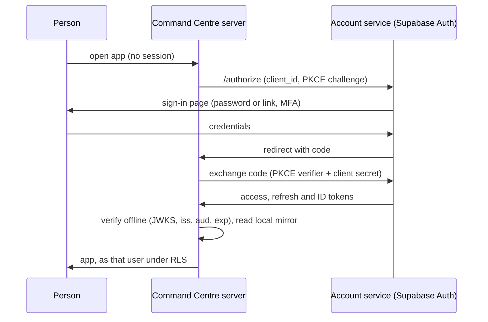
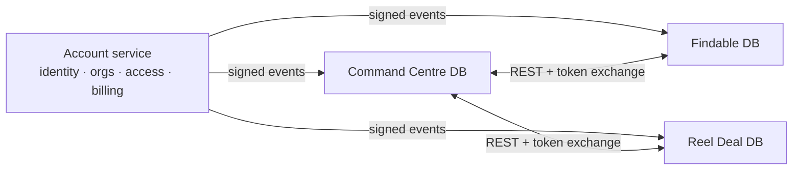

# The Outside In product ecosystem: target architecture

Status: **proposal for review**, 18 November 2026. It consolidates the approved identity decisions and
adds what they leave open. It does not assume any repository already supports it, and nothing here has
been implemented or migrated.

Sources, in order of authority:

1. Owner decisions: `docs/decisions.md` (16–17 Nov 2026), including "One account for every product" and
   the approved shared identity mechanism.
2. The account service specification (master): `anigemmill/outsideinprojects` `docs/spec.md`, with
   `docs/identity-architecture.md` (approved 17 Nov) and `docs/environments.md`.
3. Command Centre specs 02, 03, 06, 07, 10 and 13.

Where this document adds something new it says **Proposed here**. Where it describes a product's
current state it says how that was established.

## 1. Product relationship

> One Outside In customer identity, a shared organisation and membership model, and separate product
> access and entitlements. Each product stays independently usable and keeps its own data.

| Product | Responsibility | Owns (system of record) |
|---|---|---|
| **Account service** (`outsideinprojects`) | Who people are and what their organisation has bought | Users and credentials, MFA, sessions, organisations, organisation roles, memberships, invitations, product access, subscriptions, entitlements, platform staff, account audit |
| **Command Centre** | Think, plan, coordinate, analyse, measure | Workspaces, brands (shared context), strategy, intelligence, projects, campaigns, agents, approvals, reports |
| **Findable** | SEO, AEO, GEO and discoverability | Visibility runs, answers, citations, website assessments, question coverage, content briefs, search data |
| **Reel Deal** | AI video production | Its brand profiles, media, analysis, projects, storyboards, renders, exports, credit ledger |

Rule: a product never stores another product's specialist records. It stores references and summaries
(spec 07 §1).

## 2. Current state (what exists today)

| Product | Sign-in today | Organisations | How established |
|---|---|---|---|
| Account service | A2 pages built and unit-tested; never run against real Supabase Auth | Not built (A3) | Read the repository, 18 Nov |
| Command Centre | None | None | This repository, 18 Nov |
| Reel Deal | Its own Supabase Auth (email and password, cookie sessions), project `reeldeal` | Its own `organisations`, `memberships` with roles `viewer < editor < admin < owner`, `plan_id` on the organisation, credit ledger, MCP personal access tokens | Read and run in the Reel Deal session, 17 Nov |
| Findable | Its own scrypt password sessions; single-tenant; staff (FOUNDER, ADMIN) and business users (OPERATOR) in one `User` table; test-mode Stripe per business | One business per `Operator`, `UserBusiness` links | From `docs/pilot-review.md` (17 Nov). **Not re-verified tonight**: pending review of the Findable repository |

No product can accept an Outside In account token yet.

## 3. Identity and authentication

Approved (17 Nov). Summary only; the master is `identity-architecture.md`.

- One Supabase Auth per environment, in the account service: `accounts-dev`, later `accounts-prod`.
- Each product is an **OAuth 2.1 / OpenID Connect client** of it: authorisation code with PKCE, a
  confidential client secret, and tokens kept in an encrypted, httpOnly cookie on the product's domain.
- Each product verifies access tokens **offline** with the account service's JWKS: signature, exactly
  one issuer per environment, audience equal to the product, expiry.
- Each product's own Supabase Auth is locked: sign-ups off, no providers, no customer users.
- Requests run as the user: `set local role authenticated` plus the verified claims in
  `request.jwt.claims`, so `auth.uid()` and RLS work as on Supabase.
- One sign-in covers every product; signing out everywhere revokes the account session and publishes
  `session.revoked`.

**Proposed here: one token verifier package.** All three products need identical verification
(issuer pinning, audience, clock skew, JWKS caching and rotation, `amr` checks for sensitive actions).
Write it once in `packages/foundation/` beside the tokens, test it against a local issuer, and extract
it with the tokens when a second product adopts it (same rule as the decided design foundation).

## 4. Organisations and memberships

Mastered in the account service, mirrored into each product by signed events (outbox, ordered per
organisation, idempotent, nightly reconciliation). Product RLS reads only the local mirror, so no
request depends on a live call to the account service.

| Concept | Lives in | Notes |
|---|---|---|
| Organisation | Account service | The tenant and billing unit in every product; same id everywhere |
| Membership and organisation role (`owner`, `admin`, `member`, `billing`) | Account service | One invitation covers all products |
| Agency ↔ client relationship | Account service (`org_relationships`) | Client owner accepts; delegated memberships; ending it revokes them in one step (spec 03 §3) |
| Workspaces, brands | Command Centre | Product data. Reel Deal keeps its own brand profiles; Command Centre pushes brand context through the API |

**Proposed here: mirror protocol on the receiving side.** Spec 13 defines the sender. Each product
should keep `account_event_receipts (event_id primary key, org_id, seq, type, received_at)` and
`account_mirror_state (org_id, last_seq, last_reconciled_at)`. An event with a gap in `seq` is held and
triggers a fetch of the organisation's current state instead of being applied out of order.

## 5. Roles and permissions

Three layers, never merged:

| Layer | Values | Owned by |
|---|---|---|
| Organisation role | `owner`, `admin`, `member`, `billing` | Account service |
| Product access | Per member, per product: may they open it? | Account service |
| Product role | Defined by each product | Each product |

**Proposed here: role mapping for the migrations.**

| Organisation role | Command Centre default role (spec 06) | Reel Deal today | Findable today |
|---|---|---|---|
| `owner` | Owner | `owner` | primary contact `OPERATOR` |
| `admin` | Admin | `admin` | `OPERATOR` |
| `member` | Contributor (Owner/Admin can raise to Manager) | `editor` | `OPERATOR` |
| `billing` | none: billing only, no product access unless granted | none | none |
| platform staff (not an organisation role) | support session only | — | FOUNDER, ADMIN |

Rules that hold in every product:

- Organisation `owner` and `admin` can always manage members and access; product roles cannot grant
  organisation-level powers.
- A product role can only narrow, never widen, what the organisation role allows.
- Authorisation reads the mirror, never token claims (claims are hints for routing and UI).
- Permissions are checked in the service layer **and** in RLS.

## 6. Product entitlements and subscriptions

Approved: one Stripe customer per organisation in the account service; a bundle is one subscription,
a single product its own subscription (decisions 16 Nov; Findable's billing rules adopted).

- Each product defines its plans and limits in its own config; the account service assigns plans and
  computes entitlements, then publishes `entitlements.updated`.
- Product entry: no active subscription to a product → that product shows "Add [product] to your plan"
  and a link to account billing, never placeholder data.
- Features and limits: `requireEntitlement(ctx, key)` in each product's service layer.
- Downgrade or cancellation: read-only for 30 days, then locked [CONFIRM: 30 days].

**Proposed here: usage stays in the product, totals go to accounts.** Reel Deal's credits and Command
Centre's AI usage are metered in each product (they know the cost). Each product reports period totals
to the account service for invoicing and for the shared billing page; the account service never holds
per-render or per-run detail.

## 7. Shared account settings

**Proposed here** (not yet decided anywhere):

| Setting | Where | Why |
|---|---|---|
| Name, email, password, MFA, sign-in methods, sessions | Account service only | Credentials in one place |
| Profile picture, display name, locale, time zone | Account service, mirrored | Same person, same name everywhere |
| Theme preference (light, dark, follow device) | Account service, mirrored | A person who chooses dark mode expects it in every product |
| Density, collapsed navigation, saved views | Each product | Product-specific layout |
| Notification preferences | Each product, with a shared "email me about" master switch in accounts | Notifications are product events |
| Organisation name, logo, billing contact | Account service | Shared identity of the business |
| Brand guidelines | Command Centre (shared context API) | Product data, read by the others |

## 8. API communication between products

Approved (spec 07, spec 13 §5, identity-architecture §4):

- REST under `/api/v1`, `Ecosystem-Version` header, idempotency keys on writes, cursor pagination,
  shared error codes, signed webhooks.
- Acting for a signed-in person: token exchange through the account service, audience switched to the
  target product.
- Background work (agents): short-lived **service tokens** signed by the account service with its own
  key, naming the organisation and `on_behalf_of`. Never a shared database key.
- Command Centre is never granted Reel Deal's `rd:render`: spending is confirmed by a person.

## 9. Onboarding and invitations

**Proposed here** (sequence; screens follow spec 04 J1):

1. A new customer arrives from any product's website and signs up **on the account domain**: name,
   email, password (or Google/Microsoft later), then creates an organisation.
2. They are returned to the product they came from, already subscribed to its free or trial plan
   [CONFIRM: does every product have a free entry plan?].
3. The product runs its own onboarding (Command Centre: business profile checklist).
4. Inviting a teammate happens once, in the account service: email, organisation role, and which
   products they can open. Accepting creates the account if needed.
5. A person invited to a second organisation (an agency, a client) sees an organisation switcher;
   the product switcher only lists the active organisation's products.

Invitation rules: single-use hashed tokens, 7-day expiry [CONFIRM], the invitee's email must match on
acceptance, seat limits checked at invite time and again at acceptance, every step audited.

## 10. Development, staging and production

| Environment | Account service | Command Centre | Findable | Reel Deal | Data |
|---|---|---|---|---|---|
| Local | Local Postgres; tests set verified claims directly; optional local Supabase Auth runner | Local Postgres | Its own local setup | Docker Supabase stack | Synthetic |
| Development | `accounts-dev` (Outside In Development organisation, free, Sydney) | Local until first deploy, then `commandcentre-dev` | [TO CONFIRM] | [TO CONFIRM: Reel Deal's own development project] | Synthetic only |
| Staging (proposed here) | `accounts-staging`, or `accounts-dev` until a paying customer exists | Vercel preview deployments on a staging database | Staging copy used for the account migration | [TO CONFIRM] | Synthetic |
| Production | `accounts-prod` (paid organisation) | `commandcentre-prod` | Findable production | `reeldeal` (Sydney) | Real |

Rules (approved): development and production never share a project, keys, OAuth clients or secrets;
each product accepts exactly one issuer per environment and rejects the others (tested); no production
data copied into development.

**Proposed here:** a cloud development session should only be able to reach development hosts. Today
the `commandcentre` cloud environment allows both `accounts-dev` and the Reel Deal production project's
host. Keep production hosts in a separate environment used only for deliberate production work.

## 11. Migration considerations

Order (approved, decisions 17 Nov): build the account service and connect Command Centre; move a
staging copy of Findable and test; switch Findable production at an agreed quiet time with the old
sign-in kept for a week; then move Reel Deal.

| Topic | Consideration |
|---|---|
| Ids | Import existing Reel Deal and Findable users and organisations into accounts **with ids preserved**, so product rows keep their foreign keys |
| Duplicates | One person may already have a Reel Deal and a Findable login with the same email. Merge by verified email only, after the person signs in to both, never silently |
| Passwords | Reel Deal's users are already in a Supabase Auth (bcrypt). Whether Findable's scrypt hashes can be imported into Supabase Auth is **not verified**; plan for the fallback: Findable users set a new password on first sign-in through an emailed link |
| Roles | Map with §5; anything that does not map is held for review, not guessed |
| Plans | Reel Deal's `plan_id` and Findable's Stripe subscriptions become account subscriptions; product limits stay in product config |
| Personal access tokens | Reel Deal's MCP tokens are bound to its own users; they need re-issuing or re-binding to account ids |
| Fallback | Old sign-in kept read-only for a fixed window; a reversible switch per product |
| Accounts outage | Products keep serving already signed-in people (offline verification, local mirrors); only new sign-ins wait |

## 12. Open questions for the owner

1. Do shared settings (theme, locale, time zone) live in the account service (§7)?
2. Is there a staging environment before the first paying customer, or is development enough (§10)?
3. Does every product offer a free or trial entry plan at sign-up (§9)?
4. Invitation expiry (7 days?) and read-only period after cancellation (30 days?).
5. The `accounts-dev` correction (repository audit R2): recreate, or clean with a reviewed script?
