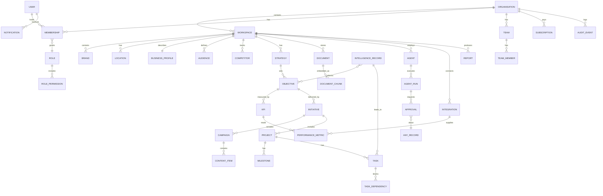

# 02 · Data model and entity relationships

Status: proposed. Covers every entity in blueprint §7. All tables follow the record conventions in
`01-technical-spec.md` §5 unless marked otherwise.

## 1. Entity relationship overview

## 2. Tables

### Tenancy and people

Rows marked **mirror** are mastered in the shared accounts service (`13`) and copied here by signed
events. Command Centre never writes them directly; changes go through the accounts API.

| Table | Key columns | Notes |
|---|---|---|
| `organisations` | `name`, `kind` (`business` \| `agency` \| `enterprise`), `region` | **Mirror.** The tenant. Not scoped by `org_id` (it *is* the org). Billing ids live in accounts |
| `org_relationships` | `agency_org_id`, `client_org_id`, `status`, `granted_by` | **Mirror.** Agency ↔ client link; see `03` |
| `workspaces` | `org_id`, `name`, `slug`, `industry`, `timezone`, `currency` | One business or business unit |
| `brands` | `workspace_id`, `name`, `positioning`, `personality`, `voice`, `visual_guidelines jsonb`, `logo_file_id` | Brand guidelines are the shared context sent to Reel Deal and Findable |
| `locations` | `workspace_id`, `name`, `address jsonb`, `geo point`, `google_place_id` | |
| `users` | `id` = accounts user id, `display_name`, `avatar_file_id`, `locale` | **Mirror** of the account profile; credentials live only in the accounts service |
| `user_preferences` | `user_id`, `theme` (`light` \| `dark` \| `system`), `density`, `nav_collapsed` | Keyed by user, not org (§18) |
| `memberships` | `org_id`, `user_id`, `org_role`, `status`, `delegated_from_org_id null` | **Mirror** of organisation membership and Command Centre `product_access` |
| `cc_access` | `org_id`, `user_id`, `role_id`, `workspace_ids uuid[] null`, `brand_ids uuid[] null` | Command Centre's own role and scope for a member; `null` arrays mean all. Exists only if the member has Command Centre access |
| `roles` | `org_id null`, `key`, `name`, `is_system` | System roles have `org_id null`; custom roles in Phase 4 |
| `permissions` | `key` (e.g. `task.write`), `description`, `risk` | Seeded, not editable by customers |
| `role_permissions` | `role_id`, `permission_key` | |
| `teams`, `team_members` | `org_id`, `name`; `team_id`, `user_id` | Ownership and workload views |
| `invitations` | — | Handled by the accounts service (one invite covers every product) |

### Business context

| Table | Key columns |
|---|---|
| `business_profiles` | `workspace_id` (unique), `description`, `category`, `website_url`, `digital_properties jsonb`, `business_model`, `revenue_streams jsonb`, `usps jsonb`, `growth_ambition`, `marketing_budget numeric`, `budget_period`, `team_structure`, `completeness smallint` |
| `offerings` | `workspace_id`, `brand_id`, `kind` (`product` \| `service` \| `experience`), `name`, `price_from`, `season jsonb`, `location_id` |
| `audiences` | `workspace_id`, `name`, `segment_type`, `demographics jsonb`, `motivations`, `channels jsonb`, `markets jsonb` |
| `competitors` | `workspace_id`, `name`, `website_url`, `positioning`, `strengths`, `weaknesses`, `findable_competitor_ref` |

### Strategy and growth

| Table | Key columns |
|---|---|
| `strategies` | `workspace_id`, `kind` (`business` \| `marketing` \| `annual_plan` \| `six_month_plan` \| `quarterly` \| `monthly_marketing`), `period_start`, `period_end`, `vision`, `mission`, `positioning`, `body jsonb` (structured sections), `status` |
| `swot_items` | `strategy_id`, `quadrant`, `text`, `evidence_ref` |
| `objectives` | `strategy_id`, `title`, `description`, `owner_id`, `period_start`, `period_end`, `status`, `priority` |
| `kpis` | `objective_id`, `name`, `unit`, `direction` (`up` \| `down`), `baseline`, `target`, `metric_key`, `source_integration_id` |
| `initiatives` | `objective_id`, `title`, `owner_id`, `status` |
| `learnings` | `workspace_id`, `text`, `source_ref`, `related_objective_id` |

### Marketing

| Table | Key columns |
|---|---|
| `campaigns` | `workspace_id`, `brand_id`, `initiative_id`, `name`, `goal`, `audience_ids uuid[]`, `channels text[]`, `start_date`, `end_date`, `budget`, `status` |
| `content_items` | `campaign_id null`, `channel`, `format`, `title`, `body`, `scheduled_at`, `published_at`, `status`, `external_ref jsonb` (e.g. Reel Deal export id) |
| `channel_plans` | `workspace_id`, `channel`, `strategy jsonb`, `period` |

### Work management

| Table | Key columns |
|---|---|
| `projects` | `workspace_id`, `objective_id`, `campaign_id`, `name`, `owner_id`, `team_id`, `budget`, `start_date`, `due_date`, `status`, `progress` (derived) |
| `milestones` | `project_id`, `title`, `due_date`, `status` |
| `tasks` | `project_id null`, `title`, `description`, `priority`, `owner_id`, `due_date`, `status` (`todo` \| `in_progress` \| `blocked` \| `in_review` \| `done`), `requires_approval`, `recurrence_rule`, `intelligence_id null`, `objective_id null` |
| `task_dependencies` | `task_id`, `depends_on_task_id` (no cycles: checked in service) |
| `comments` | `org_id`, `record_type`, `record_id`, `author_id`, `author_type`, `body` |

### Intelligence and knowledge

| Table | Key columns |
|---|---|
| `intelligence_records` | `workspace_id`, `title`, `finding`, `source_type` (§8 list), `source_ref jsonb`, `observed_at`, `evidence_class`, `claim_type` (`fact` \| `observation` \| `inference` \| `hypothesis` \| `recommendation`, adopted from the pilot), `source_claim_type`, `confidence numeric null`, `cultural_review` (`not_needed` \| `required` \| `approved`), `priority`, `impact`, `recommendation`, `owner_id`, `stage` (`finding` → `assessment` → `recommendation` → `review` → `actioned` → `measured` → `learned`) |
| `documents` | `workspace_id`, `kind` (§13 list), `title`, `file_id`, `text_extracted`, `approved_messaging bool` |
| `document_chunks` | `document_id`, `org_id`, `workspace_id`, `content`, `embedding vector(1024)`; retrieval runs under RLS (`08`) |
| `files` | `org_id`, `storage_key`, `mime`, `bytes`, `sha256` | Private R2 objects |

### AI workforce

| Table | Key columns |
|---|---|
| `agents` | `workspace_id`, `template_key`, `name`, `instructions`, `knowledge_scope jsonb`, `tools text[]`, `permission_keys text[]`, `autonomy_level smallint (1–4)`, `authorised_by`, `schedule cron null`, `triggers jsonb`, `model_policy`, `status` |
| `agent_runs` | `agent_id`, `trigger`, `principal jsonb`, `status`, `input`, `output jsonb`, `started_at`, `finished_at`, `tokens_in`, `tokens_out`, `cost_micros`, `parent_run_id` (collaboration) |
| `agent_run_steps` | `run_id`, `seq`, `kind` (`model` \| `tool` \| `handoff`), `detail jsonb` (execution trace) |
| `recommendations` | `workspace_id`, `agent_run_id null`, `intelligence_id null`, `title`, `rationale`, `proposed_action jsonb`, `status` |

### Governance

| Table | Key columns |
|---|---|
| `approvals` | `org_id`, `workspace_id`, `kind` (§14 list), `record_type`, `record_id`, `record_version`, `requested_by`, `requested_by_type`, `approver_ids uuid[]`, `submitted_at`, `decision` (`pending` \| `approved` \| `rejected` \| `changes_requested`), `decided_by`, `decided_at`, `comments`, `external_product null` |
| `audit_events` | `org_id`, `actor_id`, `actor_type`, `action`, `record_type`, `record_id`, `before jsonb`, `after jsonb`, `ip_hash`, `at` | Append-only, no `version`/`deleted_at` |
| `record_versions` | `org_id`, `record_type`, `record_id`, `version`, `snapshot jsonb`, `actor_id`, `actor_type`, `at` | Written by trigger |
| `record_links` | `org_id`, `from_type`, `from_id`, `to_type`, `to_id`, `relation` | Many-to-many links not covered by a foreign key |

### Integrations and performance

| Table | Key columns |
|---|---|
| `integrations` | `workspace_id`, `provider` (`ga4`, `search_console`, `findable`, `reel_deal`, …), `status`, `external_account_ref`, `scopes text[]`, `credential_ref` (vault id, never the secret), `last_synced_at`, `last_error` |
| `performance_metrics` | `workspace_id`, `metric_key`, `dimension jsonb`, `period_start`, `period_end`, `value numeric`, `unit`, `source_integration_id`, `evidence_class`, `fetched_at` | Partitioned by month |
| `reports` | `workspace_id`, `kind`, `period_start`, `period_end`, `body jsonb`, `file_id`, `generated_by` |
| `notifications` | `user_id`, `org_id`, `kind`, `record_type`, `record_id`, `read_at` |

### Commercial

`subscriptions` and `entitlements` are **mirrors** from the accounts service (`13`). `usage_events` and
`credit_ledger` are Command Centre's own. All are defined in `10-billing.md`.

## 3. Enumerations shared across products

`evidence_class`: `measured` · `platform_reported` · `estimated` · `ai_interpretation`. These values
are part of the integration contracts (`07`), so Findable and Reel Deal send the same ones.

## 4. Integrity rules

- A child's `org_id` and `workspace_id` must equal its parent's (composite foreign keys
  `(workspace_id, org_id)` referencing `workspaces(id, org_id)`), so a row cannot point across tenants.
- `record_links` endpoints are validated in the service layer to belong to the same organisation.
- Derived values (`progress`, `completeness`) are computed by services, never accepted from clients.
